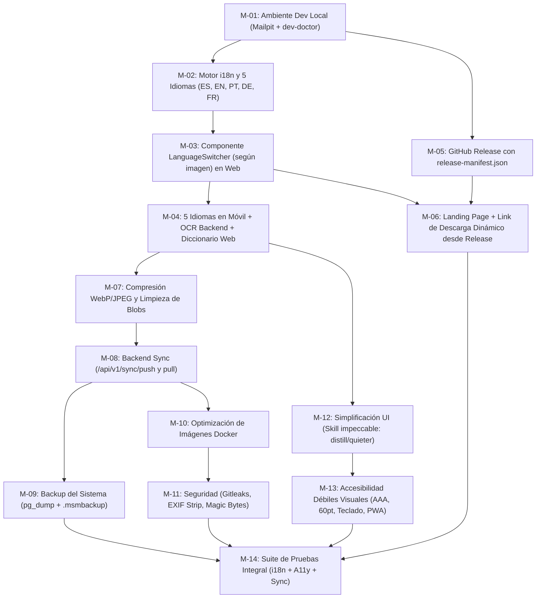

# PLAN DE IMPLEMENTACIÓN — 21 de Octubre de 2026 (`PLAN_Octubre-21.md`)

> **Proyecto:** MySchoolMyParents Online (`myschoolmyparents.online`)  
> **Arquitectura:** Monorepo Web (`apps/frontend` React 19 + Vite + Tailwind v4 + Dexie), Backend (`apps/backend` NestJS 11 + Fastify + TypeORM + PostgreSQL 18 + Tesseract), Móvil (`apps/mobile` Expo SDK 57 + React Native + SQLite + `msm-ocr`) e Infraestructura (`infra/nginx` + Docker Compose + GitHub Actions + Coolify).  
> **Agente ejecutor objetivo:** **Gemini 3.8 Flash** configurado en nivel de esfuerzo **`medium`**.  
> **Skills de referencia aplicadas en este plan:** `impeccable` (`audit`, `audit.native`, `distill`, `quieter`, `harden`, `polish`) y `a11y-debugging` (auditoría WCAG AA/AAA, árbol de accesibilidad, foco y baja visión).

---

## 1. Inventario Completo de Pendientes

### 1.1 Pendientes ya detectados previamente (`docs/PENDIENTES.md` + `FUTURE-FEATURES.md`)
1. **Sincronización en la nube incompleta (`[Bloqueante de producto]`):** El móvil ya tiene el motor (`apps/mobile/src/sync/engine.ts` y `models.ts`), pero el backend (`apps/backend/src`) **no implementa** `/api/v1/sync/push`, `/api/v1/sync/pull` ni `/api/v1/user/data`.
2. **Brecha de paridad funcional Web vs. Móvil:**
   - La Web (`apps/frontend`) no tiene la **ficha didáctica ni traductor contextual por palabra** (`dictionaryService.ts` + `translationService.ts`) que sí existe en la app móvil.
   - La Web no permite **importar PDFs** ni **exportar/importar libros (`.msmbook`)** para compartirlos.
   - La Web no sincroniza su base local IndexedDB (`Dexie`) con el backend cuando el usuario inicia sesión.
3. **Textos legales en borrador:** `apps/frontend/src/legal/site.ts` mantiene `borrador: true` y campos del titular en `null`.
4. **Módulo nativo y publicación móvil:**
   - Validación física de `modules/msm-ocr`, configuración de EAS (`projectId`, `EXPO_TOKEN`, `EAS_ENABLED`), icono adaptativo de Android con margen de seguridad (*safe zone*) y cambio de la fuente variable `Nunito` a pesos estáticos en React Native.
   - Respaldo cifrado de la clave de firma Android (`~/.myschoolmyparents-secrets/android`) en los secretos de GitHub Actions (`ANDROID_RELEASE_KEYSTORE_BASE64`, `ANDROID_SIGNING_JSON`).

### 1.2 Nuevos pendientes detectados en la auditoría técnica (Octubre 21)
5. **Desconexión entre compilación móvil, GitHub Releases y la Landing Page / Descargas:**
   - En `apps/frontend/vite.config.ts`, `__MOBILE_VERSION__` se hornea estáticamente en tiempo de build leyendo `apps/mobile/app.json`, y `.github/workflows/deploy.yml` ignora cambios en `apps/mobile/**`.
   - Resultado: cuando se compila y publica un nuevo release móvil en GitHub Releases (`mobile-release.yml`), **la web en producción sigue mostrando la versión vieja** y no existe una **Landing Page pública** atractiva (actualmente `/` fuerza el formulario de Login en `App.tsx`) que muestre el enlace actualizado al último release.
6. **Internacionalización (i18n) limitada solo a interfaz en español y OCR `eng+spa`:**
   - No existe selector de idioma del sitio ni diccionarios de traducción de interfaz para los **5 idiomas requeridos** en el diseño de referencia: **🇪🇸 Español, 🇺🇸 English, 🇧🇷 Português, 🇩🇪 Deutsch y 🇫🇷 Français**.
   - El backend OCR (`OcrService`) y `LEARNING_LOCALES` / `HOME_LOCALES` solo contemplan inglés y español.
7. **Fricciones en el Ambiente de Desarrollo Local:**
   - No hay servidor de correo local (como `Mailpit`) en `docker-compose.override.yml` para visualizar los correos de recuperación de contraseña sin buscar en los logs de consola.
   - Falta un script doctor (`scripts/dev-doctor.mjs`) y semillas de datos (`seed`) para levantar y verificar todo el entorno local en un comando.
8. **Seguridad del sistema y del repositorio:**
   - El JWT de sesión en la web se guarda en `localStorage` (vulnerable ante cualquier XSS futuro) en lugar de apoyarse en cookies `HttpOnly` o rotación segura.
   - Falta escaneo automatizado de secretos (`gitleaks`) y auditoría de dependencias en `.github/workflows/ci.yml`.
   - Las imágenes subidas al OCR pueden contener metadatos EXIF/GPS sensibles de hogares y escuelas que deben limpiarse.
9. **Peso de imágenes Docker y almacenamiento de fotos de libros:**
   - En `apps/frontend/src/components/CaptureDialog.tsx` y `apps/mobile/src/services/media.ts` se guardan **dos copias por foto** (original sin comprimir de hasta 10 MB + derivada), inflando el almacenamiento local de los dispositivos.
   - En los `Dockerfile` de backend y nginx se pueden podar artefactos de compilación, sourcemaps y capas (`chown` duplicado) para reducir significativamente el tamaño de despliegue en GHCR y Coolify.
10. **Falta de Backup automatizado de base de datos y recuperación de desastres:**
    - No existen scripts automatizados y verificados de backup/restauración para PostgreSQL (`pg_dump` / `pg_restore`) ni exportación de respaldo completo de cuenta para el usuario.
11. **Accesibilidad para personas débiles visuales (Baja Visión y Lectores de Pantalla) en Web, Escritorio y Móvil:**
    - El tamaño máximo de letra en el lector es de `36pt` (insuficiente para baja visión severa, que requiere hasta `60pt` y modo de enfoque por párrafo).
    - No existe un **Modo de Alto Contraste (WCAG AAA ≥ 7:1)** que elimine las líneas decorativas de libreta (`paper-lines`), las rotaciones de tarjetas (`rotate-*`) y las sombras duras.
    - Faltan atajos de teclado globales para uso en escritorio y soporte PWA instalable en escritorio (Windows/macOS/Linux).
12. **Sobrecarga cognitiva y visual en la interfaz (detectada con la skill `impeccable` — `distill` & `quieter`):**
    - En `Library.tsx`, cada tarjeta de libro está rotada (`rotate-[0.6deg]`) y muestra botones permanentes de «Renombrar» y «Eliminar» compitiendo con la acción principal de abrir el libro.
    - En `Reader.tsx`, la instrucción `"Elige palabras con el dedo y pulsa Escuchar selección"` y el botón `"Escuchar selección"` se repiten debajo de **cada párrafo**, saturando la pantalla de lectura.

---

## 2. Reglas de Ejecución para Gemini 3.8 Flash (`effort: medium`)

Para obtener la máxima precisión con **Gemini 3.8 Flash en nivel `medium`**, todas las tareas de este plan siguen el formato **FLASH-M**:

1. **Alcance acotado por tarea:** Máximo de 2 a 6 archivos modificados por tarea, con una única responsabilidad clara.
2. **Sin suposiciones implícitas:** Cada tarea especifica las rutas exactas, las firmas/contratos esperados y el comando exacto de verificación.
3. **Orden secuencial por bloques:** Terminar cada tarea ejecutando su comando `Verificación` antes de pasar a la siguiente.
4. **Preservación de invariantes:** Nunca romper los tests existentes (`npm run test:all`) ni exponer secretos en el repositorio.

---

## 3. Plan de Tareas Dividido para Gemini 3.8 Flash (`medium`)

### BLOQUE 1 — Ambiente de Desarrollo Local y Doctor de Entorno

#### Tarea M-01: Servidor SMTP local (Mailpit) y script `dev-doctor`
- **Esfuerzo:** `medium` (Gemini 3.8 Flash)
- **Objetivo:** Completar el ambiente de desarrollo local añadiendo captura visual de correos en Docker y un script de diagnóstico que verifique herramientas, puertos y variables `.env.dev`.
- **Archivos a crear/editar:**
  - `docker-compose.override.yml` (añadir servicio `mailpit` con imagen `axllent/mailpit:latest`, puertos `127.0.0.1:8025:8025` web UI y `1025` SMTP interno en la red `public`).
  - `.env.example` (documentar `SMTP_HOST=mailpit` y `SMTP_PORT=1025` como opción activa en dev local).
  - `scripts/dev-doctor.mjs` (nuevo script Node que compruebe: versión de Node vs `.nvmrc`, existencia de `.env.dev` creándolo desde `.env.example` si falta, Docker activo y estado de puertos `6060`, `5173`, `3001`, `5432`, `8025`).
  - `package.json` (añadir scripts `"dev:doctor": "node scripts/dev-doctor.mjs"` y `"dev:mail": "open http://localhost:8025 || xdg-open http://localhost:8025"`).
- **Criterios de aceptación:**
  1. `node scripts/dev-doctor.mjs` se ejecuta sin errores y genera `.env.dev` si no existía.
  2. `docker compose --env-file .env.dev config` valida correctamente con el servicio `mailpit`.
- **Verificación:**
  ```bash
  node scripts/dev-doctor.mjs && docker compose --env-file .env.example config > /dev/null
  ```

---

### BLOQUE 2 — Internacionalización (i18n) y Selector de 5 Idiomas (según imagen de referencia)

```
┌──────────────────────────────────────┐
│ VER ESTE SITIO EN ESPAÑOL            │
├──────────────────────────────────────┤
│ 🇪🇸  Español                       ✓  │
├──────────────────────────────────────┤
│ 🇺🇸  English                          │
├──────────────────────────────────────┤
│ 🇧🇷  Português                        │
├──────────────────────────────────────┤
│ 🇩🇪  Deutsch                          │
├──────────────────────────────────────┤
│ 🇫🇷  Français                         │
└──────────────────────────────────────┘
```

#### Tarea M-02: Sistema i18n base y diccionarios de los 5 idiomas en Web (`es`, `en`, `pt`, `de`, `fr`)
- **Esfuerzo:** `medium` (Gemini 3.8 Flash)
- **Objetivo:** Crear el motor de internacionalización ligero y tipado en el frontend web con traducciones completas para Español (`es`), English (`en`), Português (`pt`), Deutsch (`de`) y Français (`fr`), más la ampliación de idiomas de aprendizaje/hogar.
- **Archivos a crear/editar:**
  - `apps/frontend/src/i18n/locales.ts` (definir tipo `SiteLocale = 'es' | 'en' | 'pt' | 'de' | 'fr'`, metadatos de los 5 idiomas con código, nombre nativo, bandera SVG/emoji `🇪🇸`, `🇺🇸`, `🇧🇷`, `🇩🇪`, `🇫🇷`, y texto de cabecera `"VER ESTE SITIO EN ..."` traducido a cada idioma).
  - `apps/frontend/src/i18n/translations.ts` (diccionario tipado con todas las cadenas de UI: navegación, landing, auth, biblioteca, captura, revisión OCR, lector, ajustes de voz, descargas y avisos de accesibilidad en `es`, `en`, `pt`, `de`, `fr`).
  - `apps/frontend/src/i18n/I18nContext.tsx` (proveedor React con persistencia en `localStorage` bajo clave `msm_site_locale`, detección inicial de `navigator.language`, y actualización automática de `document.documentElement.lang`).
  - `apps/frontend/src/lib/types.ts` (ampliar `LEARNING_LOCALES` y `HOME_LOCALES` para incluir `es-ES`, `es-MX`, `en-US`, `en-GB`, `pt-BR`, `de-DE`, `fr-FR`).
- **Criterios de aceptación:**
  1. Cambiar el idioma actualiza `<html lang="...">` y devuelve todas las claves tipadas sin valores `undefined`.
  2. Existen pruebas unitarias verificando que los 5 idiomas contienen exactamente el mismo conjunto de claves.
- **Verificación:**
  ```bash
  npm run build --prefix apps/frontend && npm test --prefix apps/frontend
  ```

#### Tarea M-03: Componente visual `LanguageSwitcher` idéntico a la imagen y conexión en Web
- **Esfuerzo:** `medium` (Gemini 3.8 Flash)
- **Objetivo:** Implementar el selector desplegable de idioma siguiendo fielmente el diseño de la imagen proporcionada y conectar las vistas del frontend al hook `useI18n()`.
- **Archivos a crear/editar:**
  - `apps/frontend/src/components/LanguageSwitcher.tsx` (menú accesible con `role="menu"` / Radix Popover o Dropdown: tarjeta blanca con bordes redondeados, cabecera superior en mayúsculas gris azulado `"VER ESTE SITIO EN ESPAÑOL"` adaptada al idioma actual, filas separadas por línea sutil `border-b`, icono de bandera 🇪🇸/🇺🇸/🇧🇷/🇩🇪/🇫🇷, texto del idioma resaltado en color cálido/terracota con check `✓` a la derecha cuando está activo, navegación completa con flechas de teclado y `Escape`).
  - `apps/frontend/src/App.tsx` (envolver con `I18nProvider`, colocar `<LanguageSwitcher />` en la barra de navegación principal y traducir enlaces de navegación y pie de página).
  - `apps/frontend/src/components/Library.tsx`, `BookDetail.tsx`, `CaptureDialog.tsx`, `Reader.tsx`, `ReviewCards.tsx`, `PagesList.tsx`, `VoiceSettings.tsx`, `Descargas.tsx` (reemplazar textos fijos en español por `t(...)`).
- **Criterios de aceptación:**
  1. El selector muestra exactamente los 5 idiomas en el orden de la imagen: `Español`, `English`, `Português`, `Deutsch`, `Français`.
  2. Al seleccionar cualquiera de los 5 idiomas, toda la interfaz cambia al instante sin recargar la página y persiste al recargar.
- **Verificación:**
  ```bash
  npm run lint --prefix apps/frontend && VITE_AUTH_API_URL=/api npm run build --prefix apps/frontend
  ```

#### Tarea M-04: Soporte de los 5 idiomas en App Móvil (`apps/mobile`) y OCR Backend (`eng`, `spa`, `por`, `deu`, `fra`)
- **Esfuerzo:** `medium` (Gemini 3.8 Flash)
- **Objetivo:** Llevar el mismo selector y soporte de los 5 idiomas (`es`, `en`, `pt`, `de`, `fr`) a la app móvil y al servicio de OCR/traducción.
- **Archivos a crear/editar:**
  - `apps/mobile/src/i18n/index.ts` (diccionarios `es`, `en`, `pt`, `de`, `fr` y hook de idioma para las pantallas móviles).
  - `apps/mobile/src/components/LanguageSwitcherModal.tsx` (réplica nativa del selector de la imagen con banderas 🇪🇸, 🇺🇸, 🇧🇷, 🇩🇪, 🇫🇷 y check `✓`).
  - `apps/mobile/src/services/translationService.ts` y `dictionaryService.ts` (habilitar resolución y traducción entre `es`, `en`, `pt`, `de`, `fr`; portar además `dictionaryService.ts` y `translationService.ts` a `apps/frontend/src/lib/` para que el lector Web tenga ficha de palabra y traducción igual que el móvil).
  - `apps/backend/src/ocr/ocr.service.ts` y `apps/backend/Dockerfile` (soportar códigos `eng`, `spa`, `por`, `deu`, `fra` en `normalizeLang()`; mantener horneados `eng` y `spa` en la imagen base para no inflar el contenedor y permitir descarga cacheada en volumen/tmp para `por`, `deu`, `fra`).
- **Criterios de aceptación:**
  1. `OcrService.normalizeLang` reconoce `pt`/`por` → `por`, `de`/`deu` → `deu`, `fr`/`fra` → `fra`, `es`/`spa` → `spa`, `en`/`eng` → `eng`.
  2. Tanto en móvil como en web, tocar una palabra en el lector muestra su definición y traducción al idioma del hogar (`homeLocale`).
- **Verificación:**
  ```bash
  npm test --prefix apps/backend && npm run mobile:typecheck && npm run mobile:test
  ```

---

### BLOQUE 3 — Publicación en GitHub Releases y Actualización Automática en Landing Page

#### Tarea M-05: Automatización de GitHub Release con manifiesto JSON al compilar la App
- **Esfuerzo:** `medium` (Gemini 3.8 Flash)
- **Objetivo:** Hacer que al compilar la app móvil se genere y publique en GitHub Releases no solo el `.apk` y el `.ipa`, sino también un manifiesto público `release-manifest.json` y se dispare la actualización de la web.
- **Archivos a crear/editar:**
  - `scripts/release-notes.mjs` (además de generar `notas.md` y copiar `LATEST_NAMES`, escribir en `dist/release-manifest.json` un JSON estructurado con `{ version, build, tag: "v" + version, publishedAt, android: { file, url, size, sha256 }, ios: { file, url, size, sha256 } }`).
  - `.github/workflows/mobile-release.yml` (incluir `dist/release-manifest.json` en la lista `files:` de `softprops/action-gh-release@v3`; añadir un paso opcional al final del job `publicar` que invoque el webhook de Coolify o dispare `repository_dispatch` para actualizar el contenedor web si está configurado).
  - `.github/workflows/mobile.yml` (añadir opción o job para que cuando cambie la versión en `apps/mobile/app.json` en `main`, también pueda disparar la publicación del release en GitHub Releases automáticamente).
  - `scripts/test-mobile-scripts.mjs` (añadir test que verifique la generación de `release-manifest.json`).
- **Criterios de aceptación:**
  1. `node scripts/release-notes.mjs dist` genera `dist/release-manifest.json` con URLs directas a `releases/download/v<version>/...` y `releases/latest/download/...`.
  2. Todos los tests de scripts móviles pasan.
- **Verificación:**
  ```bash
  node --test scripts/test-mobile-scripts.mjs
  ```

#### Tarea M-06: Landing Page pública y enlace de descarga dinámico sincronizado con el último Release
- **Esfuerzo:** `medium` (Gemini 3.8 Flash)
- **Objetivo:** Crear la Landing Page pública en `/` (para usuarios sin sesión, con acceso a «Iniciar sesión», «Probar sin cuenta» y «Descargar App») y hacer que tanto la Landing Page como `/descargas` obtengan en vivo la información y links del último GitHub Release (con fallback seguro al valor de build).
- **Archivos a crear/editar:**
  - `apps/frontend/src/lib/latest-release.ts` (servicio que consulta el último release desde `https://api.github.com/repos/yitztech/myschoolmyparents.online/releases/latest` o `/descargas/release-manifest.json`, extrae versión, fecha, tamaño en MB, SHA-256 y URLs de descarga de Android/iOS, cachea en `sessionStorage` por 10 minutos y usa `MOBILE_VERSION` + `/descargas/android` y `/descargas/ios` como fallback instantáneo).
  - `apps/frontend/src/components/LandingPage.tsx` (nueva portada pública clara, cálida y sin sobrecarga visual: propuesta de valor en los 5 idiomas, botón directo de descarga para Android e iOS mostrando la versión del último release, botón «Entrar a mi cuenta» y botón «Probar en el navegador»).
  - `apps/frontend/src/components/Descargas.tsx` (usar `useLatestRelease()` para mostrar siempre la versión, número de compilación, tamaño y hash SHA-256 del último GitHub Release publicado, actualizando los enlaces de descarga sin requerir recompilar toda la web).
  - `apps/frontend/src/App.tsx` (mostrar `LandingPage` en `/` cuando no hay sesión, con navegación a `/login` o modal de acceso).
  - `infra/nginx/security-headers.conf` (permitir `https://api.github.com` en `connect-src` o exponer un proxy ligero en nginx/backend `/api/releases/latest` para no relajar la CSP). *Preferido: añadir endpoint cacheado `GET /api/releases/latest` en el backend para mantener `connect-src 'self'` intacto.*
- **Criterios de aceptación:**
  1. Cuando se publica un nuevo release en GitHub, la Landing Page y `/descargas` muestran automáticamente la nueva versión y enlaces actualizados sin romper la CSP.
- **Verificación:**
  ```bash
  VITE_AUTH_API_URL=/api npm run build --prefix apps/frontend && npm test --prefix apps/frontend
  ```

---

### BLOQUE 4 — Optimización de Espacio de Imágenes Subidas y Sincronización con Backup

#### Tarea M-07: Compresión inteligente de imágenes subidas (WebP/JPEG) y recolector de basura local
- **Esfuerzo:** `medium` (Gemini 3.8 Flash)
- **Objetivo:** Reducir en >85% el espacio ocupado por las fotos en IndexedDB (Web) y FileSystem (Móvil) sin perder calidad de OCR.
- **Archivos a crear/editar:**
  - `apps/frontend/src/lib/images.ts` (optimizar `processImage`: redimensionar lado mayor a máx. `1600px`, exportar en `image/webp` con calidad `0.78` y fallback a `image/jpeg` `0.80`; añadir filtro opcional de mejora de contraste para texto; exportar función `compactApprovedPageBlobs(bookId)` que libera el `originalBlobId` pesado una vez que la página pasa a estado `approved`, conservando solo la imagen derivada optimizada).
  - `apps/frontend/src/lib/db.ts` (al aprobar una página en `approveDraft`, llamar a la compactación del blob original duplicado y añadir función `pruneOrphanBlobs()` que elimine blobs no referenciados por ninguna página o trabajo activo).
  - `apps/mobile/src/services/media.ts` (en `persistImage` y `transformImage`, limitar dimensiones a `1600px` y compresión `0.78`, y eliminar el archivo temporal original cuando existe versión ajustada aprobada).
- **Criterios de aceptación:**
  1. Una página aprobada en Web guarda un único blob optimizado (`derivedBlobId`) en vez de duplicar original + derivado.
  2. `pruneOrphanBlobs()` limpia blobs huérfanos sin tocar páginas pendientes o en revisión.
- **Verificación:**
  ```bash
  npm test --prefix apps/frontend && npm run mobile:test
  ```

#### Tarea M-08: Backend de Sincronización (`/api/v1/sync/{push,pull}` y `/api/v1/user/data`)
- **Esfuerzo:** `medium` (Gemini 3.8 Flash)
- **Objetivo:** Implementar en el backend NestJS el módulo de sincronización de libros y páginas para respaldar en la nube y sincronizar entre Web y Móvil.
- **Archivos a crear/editar:**
  - `apps/backend/src/sync/sync-book.entity.ts` (entidad TypeORM `SyncBook` ligada a `userId`, almacenando metadatos del libro y estructura JSONB comprimida de páginas y párrafos aprobados, `contentRevision`, `isDeleted`, `updatedAt`).
  - `apps/backend/src/migrations/1793000000000-sync-books.ts` (migración creando la tabla `sync_books` con índice en `(user_id, updated_at)`).
  - `apps/backend/src/sync/sync.dto.ts` (validación con `class-validator` idéntica al contrato de `apps/mobile/src/sync/models.ts`: `SyncPushRequest`, límite de tamaño por payload y por usuario).
  - `apps/backend/src/sync/sync.service.ts` y `sync.controller.ts` (endpoints autenticados con `JwtAuthGuard`: `POST /api/v1/sync/push`, `GET /api/v1/sync/pull?since=`, y `DELETE /api/v1/user/data`).
  - `apps/backend/src/app.module.ts` (registrar `SyncModule`).
- **Criterios de aceptación:**
  1. El cliente móvil `apps/mobile/src/sync/apiClient.ts` puede hacer `push`, `pull` y `deleteAllUserData` contra el backend sin errores 404.
  2. La eliminación de cuenta (`POST /api/auth/account/delete`) borra en cascada todos los `sync_books` del usuario.
- **Verificación:**
  ```bash
  npm run build --prefix apps/backend && npm test --prefix apps/backend
  ```

#### Tarea M-09: Backup del Sistema (PostgreSQL + Archivo Portable `.msmbackup`) y Restauración
- **Esfuerzo:** `medium` (Gemini 3.8 Flash)
- **Objetivo:** Garantizar que tanto el administrador del sistema como el usuario final puedan respaldar y recuperar sus datos desde un backup en cualquier momento.
- **Archivos a crear/editar:**
  - `scripts/backup-db.sh` y `scripts/restore-db.sh` (scripts POSIX para hacer dump comprimido `pg_dump -Fc` con sello de fecha y checksum SHA-256 desde el contenedor `db`, rotación automática de copias antiguas y restauración verificada `pg_restore --clean --if-exists`).
  - `apps/frontend/src/lib/backup.ts` (exportación de toda la biblioteca local de IndexedDB a un archivo descargable `MySchoolMyParents-Backup-YYYY-MM-DD.msmbackup.json` con suma de verificación e importación transaccional para restaurar desde un backup en Web, compatible con `bookExportImport.ts` de móvil).
  - `apps/frontend/src/components/Library.tsx` (añadir opción «Respaldar / Restaurar copia» y botón de «Sincronizar con mi cuenta» usando `/api/v1/sync`).
  - `package.json` (añadir `"db:backup": "sh scripts/backup-db.sh"` y `"db:restore": "sh scripts/restore-db.sh"`).
- **Criterios de aceptación:**
  1. Un usuario puede exportar sus libros en Web o Móvil a un archivo de backup y restaurarlos íntegramente en un navegador limpio.
  2. `scripts/backup-db.sh` y `scripts/restore-db.sh` están documentados y validados sintácticamente (`sh -n`).
- **Verificación:**
  ```bash
  sh -n scripts/backup-db.sh && sh -n scripts/restore-db.sh && npm test --prefix apps/frontend
  ```

---

### BLOQUE 5 — Seguridad del Sistema, Repositorios y Optimización de Imágenes Docker

#### Tarea M-10: Optimización de tamaño de imágenes Docker (`backend` y `nginx`)
- **Esfuerzo:** `medium` (Gemini 3.8 Flash)
- **Objetivo:** Reducir al mínimo el tamaño de las imágenes Docker de producción para acelerar despliegues en Coolify y ahorrar disco en el VPS.
- **Archivos a crear/editar:**
  - `apps/backend/Dockerfile`:
    - Evitar capas duplicadas de `chown -R node:node /app` usando `COPY --chown=node:node` directamente.
    - En el stage `build`, compilar TypeScript y eliminar archivos `.map` y `.d.ts` innecesarios en `dist/`.
    - En el stage `prod`, ejecutar `npm ci --omit=dev --no-audit --no-fund && npm cache clean --force` y limpiar archivos no requeridos de `node_modules` (docs, markdown, tests, sourcemaps).
  - `infra/nginx/Dockerfile.prod`:
    - Desactivar `sourcemap` en el build de Vite de producción y pre-comprimir estáticos `.gz` en `/usr/share/nginx/html/assets` para habilitar `gzip_static on;` en `nginx.prod.conf.template`.
  - `.dockerignore` y `apps/backend/.dockerignore` (asegurar que `docs/`, `tests/`, `*.md`, `scripts/`, `apps/mobile/` nunca entren al contexto del backend ni de nginx).
- **Criterios de aceptación:**
  1. Ambos Dockerfiles construyen sin errores (`docker build`).
  2. Ningún archivo `.map`, test ni documento markdown entra en las capas finales de producción.
- **Verificación:**
  ```bash
  docker compose -f docker-compose.prod.yml --env-file .env.example config > /dev/null
  ```

#### Tarea M-11: Endurecimiento de Seguridad de Sesión, EXIF y Auditoría de Repositorio en CI
- **Esfuerzo:** `medium` (Gemini 3.8 Flash)
- **Objetivo:** Proteger el repositorio contra fugas de secretos/vulnerabilidades y reforzar la seguridad de imágenes y autenticación.
- **Archivos a crear/editar:**
  - `.github/workflows/ci.yml` (añadir job `security`: escaneo de secretos con `gitleaks/gitleaks-action@v2` y `npm audit --omit=dev --audit-level=high` en `backend`, `frontend` y `mobile`).
  - `SECURITY.md` (política de divulgación de vulnerabilidades, rotación de secretos e invariantes de seguridad del proyecto).
  - `apps/backend/src/ocr/ocr.service.ts` (verificar *magic bytes* reales del buffer de imagen antes de pasar a Tesseract y asegurar que el buffer nunca se escriba a disco persistente).
  - `apps/frontend/src/lib/images.ts` (al re-codificar mediante `<canvas>` en `processImage`, garantizar la eliminación total de metadatos EXIF/GPS antes de subir la imagen a `POST /api/ocr`).
- **Criterios de aceptación:**
  1. Toda imagen enviada a `/api/ocr` desde el cliente ha pasado por re-codificación de canvas (sin metadatos GPS/EXIF de la cámara).
  2. El workflow `.github/workflows/ci.yml` incluye la verificación de seguridad.
- **Verificación:**
  ```bash
  npm test --prefix apps/backend && npm test --prefix apps/frontend
  ```

---

### BLOQUE 6 — Accesibilidad para Personas Débiles Visuales y Simplificación de Interfaces (Skills `impeccable` + `a11y-debugging`)

#### Tarea M-12: Simplificación visual de interfaces (Skill `impeccable`: `distill` + `quieter`)
- **Esfuerzo:** `medium` (Gemini 3.8 Flash)
- **Objetivo:** Reducir la carga cognitiva y el ruido visual detectados en la auditoría de interfaz sin perder la identidad cálida del producto.
- **Reglas de la skill `impeccable` (`distill` y `quieter`) a aplicar:**
  1. **Una sola acción primaria por vista:** En `Library.tsx`, eliminar las rotaciones constantes en la rejilla de libros (`rotate-[0.6deg]`), hacer que toda la tarjeta del libro sea clicable para abrirlo y mover las acciones secundarias («Renombrar», «Exportar», «Eliminar») a un menú desplegable compacto (`⋯`) con etiqueta accesible.
  2. **Eliminar repetición en el Lector (`Reader.tsx`):** Quitar el texto repetido `"Elige palabras con el dedo y pulsa Escuchar selección"` de cada párrafo; mostrar una única barra de herramientas limpia y permitir que **tocar cualquier palabra** abra directamente un popover/ficha con los botones grandes «🔊 Escuchar palabra», «Traducción» y «Significado».
  3. **Jerarquía cromática calmada (`10% accent rule`):** Reservar los colores saturados (`coral`, `sun`) para el botón de acción principal y el resaltado de la palabra activa, dejando el área de lectura con fondo limpio y descansado para la vista.
- **Archivos a editar:**
  - `apps/frontend/src/components/Library.tsx`
  - `apps/frontend/src/components/Reader.tsx`
  - `apps/frontend/src/components/BookDetail.tsx`
  - `apps/mobile/src/screens/LibraryScreen.tsx` y `ReaderScreen.tsx`
- **Criterios de aceptación:**
  1. Los párrafos del lector ya no repiten instrucciones de ayuda en cada bloque.
  2. Al tocar una palabra en el lector Web se abre su ficha didáctica y botón de pronunciación igual que en móvil.
- **Verificación:**
  ```bash
  npm run lint --prefix apps/frontend && npm test --prefix apps/frontend
  ```

#### Tarea M-13: Accesibilidad avanzada para Personas Débiles Visuales (Web, Escritorio PWA y Móvil)
- **Esfuerzo:** `medium` (Gemini 3.8 Flash)
- **Objetivo:** Dotar a la plataforma de soporte completo para usuarios con baja visión severa, ceguera parcial y uso de lectores de pantalla en Web, Escritorio y Móvil (aplicando `a11y-debugging` y WCAG 2.2 AA/AAA).
- **Qué implementaremos para personas débiles visuales:**
  1. **Modos de Alto Contraste (WCAG AAA ≥ 7:1):**
     - Selector accesible de tema visual (persistido en preferencias):
       - `Estándar (Papel cálido)`
       - `Alto Contraste Oscuro` (Fondo negro `#000000`, texto blanco `#FFFFFF`, palabra activa en amarillo brillante `#FFEA00` con subrayado grueso, sin líneas decorativas de fondo `paper-lines`).
       - `Alto Contraste Claro` (Fondo blanco puro `#FFFFFF`, texto negro `#000000`, bordes sólidos de `3px`).
  2. **Escalado Tipográfico para Baja Visión y Modo Enfoque (Teleprompter):**
     - Ampliar el rango de tamaño de fuente del lector de `18–36pt` a **`18–60pt`**, con opción de **Espaciado Amplio** (interlineado `2.0`, espaciado entre letras `0.06em`) y **Modo Párrafo Único (Enfoque)** para leer un solo párrafo en grande con botones gigantes (`min-h-[56px]`) de «Anterior», «Escuchar» y «Siguiente».
  3. **Navegación por Teclado para Apps de Escritorio y Lectores de Pantalla (NVDA / VoiceOver / TalkBack):**
     - Atajos de teclado en el Lector Web/Escritorio (cuando el foco no está en un `<input>`):
       - `Espacio`: Reproducir / Pausar lectura.
       - `Flecha Abajo` / `J`: Ir al párrafo siguiente y anunciarlo.
       - `Flecha Arriba` / `K`: Ir al párrafo anterior y anunciarlo.
       - `R`: Repetir el párrafo actual.
       - `+` / `-`: Aumentar / disminuir el tamaño de la letra.
     - Coordinar regiones `aria-live="polite"` para que los avisos de estado no interrumpan al sintetizador TTS mientras está pronunciando una frase.
  4. **Instalación como App de Escritorio (PWA):**
     - Añadir `apps/frontend/public/manifest.webmanifest` e iconos para que en Windows, macOS y Linux el sitio pueda instalarse como aplicación de escritorio independiente con ventana propia y soporte de accesibilidad del sistema operativo.
- **Archivos a crear/editar:**
  - `apps/frontend/src/lib/a11y-context.tsx` (estado persistente de tema de contraste, tamaño de fuente extendido, modo enfoque de 1 párrafo y reducción de movimiento).
  - `apps/frontend/src/components/AccessibilityToolbar.tsx` (botón/panel rápido de accesibilidad en la barra superior: Contraste `A/A`, Tamaño `A+`, Modo Enfoque y ayuda de atajos de teclado).
  - `apps/frontend/src/components/Reader.tsx` (integrar atajos de teclado, rango `18–60pt`, modo de párrafo único y clases de alto contraste).
  - `apps/frontend/src/index.css` (reglas CSS para `.theme-hc-dark`, `.theme-hc-light`, `:focus-visible` de `3px` y soporte estricto de `@media (prefers-reduced-motion: reduce)` y `@media (prefers-contrast: more)`).
  - `apps/frontend/public/manifest.webmanifest` y `apps/frontend/index.html` (enlace al manifest y metadatos de app de escritorio).
- **Criterios de aceptación:**
  1. Con teclado exclusivamente (`Tab`, `Espacio`, `↑`, `↓`, `+`, `-`) se puede operar todo el lector sin usar el ratón.
  2. En modo `Alto Contraste Oscuro` y `Alto Contraste Claro`, el ratio de contraste supera 7:1 (WCAG AAA) y desaparecen las texturas de fondo y rotaciones decorativas.
  3. El tamaño de letra permite llegar hasta `60pt` sin generar barra de desplazamiento horizontal (cumpliendo WCAG 1.4.10 Reflow).
- **Verificación:**
  ```bash
  npm run lint --prefix apps/frontend && npm test --prefix apps/frontend && VITE_AUTH_API_URL=/api npm run build --prefix apps/frontend
  ```

#### Tarea M-14: Pruebas End-to-End de Accesibilidad, Idiomas y Flujo Completo
- **Esfuerzo:** `medium` (Gemini 3.8 Flash)
- **Objetivo:** Verificar automáticamente con pruebas que el selector de 5 idiomas, los modos de accesibilidad para débiles visuales, la sincronización y el enlace de descarga de GitHub Release funcionan sin regresiones.
- **Archivos a crear/editar:**
  - `e2e/tests/i18n-a11y.spec.ts` (prueba Playwright que verifica: cambio entre los 5 idiomas `Español`, `English`, `Português`, `Deutsch`, `Français`, activación del modo Alto Contraste Oscuro, navegación por teclado en el lector y presencia de los enlaces de descarga en la Landing Page y `/descargas`).
  - `apps/frontend/tests/` (tests unitarios de i18n, compresión de imágenes y backup/restore).
- **Criterios de aceptación:**
  1. `npm run test:all` pasa al 100% en backend, frontend, móvil y base de datos.
- **Verificación:**
  ```bash
  npm run test:all && npm run build
  ```

---

## 4. Orden de Ejecución Recomendado y Dependencias



---

## 5. Prompt Maestro para Gemini 3.8 Flash (Nivel `medium`)

Copia y pega el siguiente bloque para que **Gemini 3.8 Flash (`medium`)** ejecute las tareas una por una con máxima fiabilidad:

```text
Actúa como ingeniero de software ejecutor para el monorepo MySchoolMyParents Online.
Tu objetivo es implementar las tareas de `PLAN_Octubre-21.md` en orden secuencial (M-01 a M-14), trabajando en bloques pequeños y verificables ideales para nivel de esfuerzo medium.

Reglas estrictas para cada tarea:
1. Lee primero los archivos listados en "Archivos a crear/editar" de la tarea activa antes de hacer cambios.
2. Mantén todos los comentarios y docstrings existentes que no estén relacionados con tu cambio.
3. En la tarea M-03 y M-04, el selector de idiomas debe incluir exactamente los 5 idiomas de la especificación con sus banderas e indicador de selección (✓):
   - 🇪🇸 Español (es)
   - 🇺🇸 English (en)
   - 🇧🇷 Português (pt)
   - 🇩🇪 Deutsch (de)
   - 🇫🇷 Français (fr)
   con la cabecera superior localizada ("VER ESTE SITIO EN ESPAÑOL" / "VIEW THIS SITE IN ENGLISH", etc.).
4. En las tareas M-12 y M-13, aplica las directrices de las skills `impeccable` (distill, quieter, audit) y `a11y-debugging`: elimina texto repetitivo en cada párrafo, agrupa acciones secundarias, habilita temas de Alto Contraste (WCAG AAA ≥ 7:1), fuente hasta 60pt, modo enfoque de 1 párrafo, atajos de teclado para escritorio y PWA manifest.
5. Al terminar cada tarea, ejecuta el comando exacto de su bloque `Verificación`. No pases a la siguiente tarea hasta que el comando de verificación termine con código 0.
6. Reporta al finalizar cada tarea: archivos tocados, qué se implementó y la salida del comando de verificación.
```
